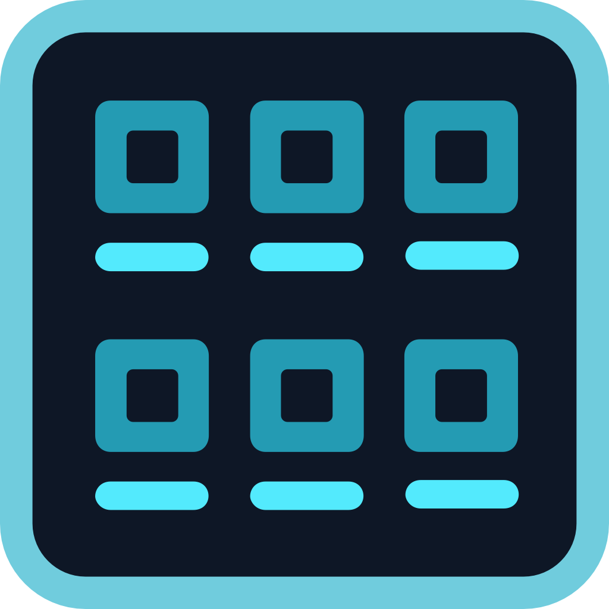

<p align="center">
  
</p>

## 🗂️ CyberTray {{VERSION}}: Release Notes

### 🚀 What's new in this release

<!-- IMPORTANT FOR AGENTS & MAINTAINERS: Always rewrite this entire section and highlights with the ACTUAL release notes for this specific new version before tagging. NEVER leave or copy previous version notes! Use 25-45 words for the summary, lead with user-facing changes, and do not repeat the app name or version. Keep the Spanish mirror inside the details block in sync: translate the summary and rewrite the highlights. -->
<!-- COVERAGE: list every commit since the previous tag before drafting. Give every user-facing change at least one highlight and group related commits into one. Skip internal refactors, CI, tests and dependency bumps with no visible effect; keep small visible fixes such as copy, tooltips, shortcuts, themes, icons, spacing, stability and perceptible performance. Review the draft if 15+ user-facing commits produce fewer than 6 highlights, or 40+ total commits fewer than 8. Patch releases may have 1-3 highlights or a plain maintenance-only note. -->
<!-- changelog-summary:start -->
Eliminates system tray menu flicker on repeated opens and position jumps across mixed-DPI monitors using a fresh prewarmed tray window with two-step reveal, aligns the flyout gap to 4px, and adds Exit to the titlebar More menu.
<!-- changelog-summary:end -->

> **New to CyberTray?** A system tray launchpad for Windows with a searchable shelf of apps, files and links, live system telemetry, a process viewer, and a PIN-protected vault.

---

### ✨ Key Features & Highlights

- 🪟 **Flicker-free multi-monitor tray menu**: Replaced window hide/reuse with a fresh prewarmed tray window and two-step transparent reveal so repeated clicks and mixed-DPI monitor switches open cleanly with a `4px` flyout gap.
- 🚪 **Exit from the titlebar menu**: Added an `Exit CyberTray` item to the titlebar More menu for quick full shutdown without using the system tray.

<details>
<summary><b>🇪🇸 Ver notas de la versión en Español</b></summary>

### 🚀 Novedades de esta versión

Elimina el parpadeo del menú de bandeja en aperturas repetidas y los saltos de posición entre monitores con DPI mixto mediante una ventana precalentada con revelado en dos pasos, ajusta el espacio de flyouts a 4px y añade Salir al menú Más.

> **¿Nuevo en CyberTray?** Un lanzador desde la bandeja del sistema para Windows, con una estantería con búsqueda de apps, archivos y enlaces, telemetría del sistema en vivo, visor de procesos y bóveda protegida con PIN.

---

### ✨ Novedades destacadas

- 🪟 **Menú de bandeja sin parpadeos en multimonitor**: Se reemplazó la reutilización tras ocultar por una ventana precalentada con revelado transparente en dos pasos para abrir sin parpadeos ni saltos entre monitores con DPI mixto y con un espacio de `4px` entre flyouts.
- 🚪 **Opción Salir en la barra de título**: Se agregó `Salir de CyberTray` al menú Más de la barra de título para cerrar la aplicación por completo sin pasar por la bandeja del sistema.

### ℹ️ Antes de instalar

- **Windows:** esta versión aún no está firmada digitalmente. SmartScreen puede avisar antes de ejecutarla: **Más información › Ejecutar de todas formas**. Cuando Smart App Control está activado, Windows rechaza programas sin firmar; consulta la [política de firma de código](https://github.com/CyberGems/.github/blob/main/CODE_SIGNING.md). Verifica la descarga con los checksums SHA256 que aparecen más abajo.

</details>

---

### ℹ️ Before you install

- **Windows:** this release is not code-signed yet. SmartScreen may ask before it runs: **More info › Run anyway**. Where Smart App Control is on, Windows refuses unsigned programs; see the [code signing policy](https://github.com/CyberGems/.github/blob/main/CODE_SIGNING.md). Verify the download with the SHA256 checksums below.

---

### 📦 Downloads & Packages

> ⬇️ **Direct download:** click a file name to download it now. Same files as in **Assets** at the bottom of this page.

| File | Description | Platform |
| :--- | :--- | :--- |
| **[`CyberTray-Setup-{{VERSION_NUM}}.exe`](https://github.com/CyberGems/CyberTray/releases/download/{{VERSION}}/CyberTray-Setup-{{VERSION_NUM}}.exe)** | 🚀 **Recommended Installer** (NSIS Setup with Start Menu & Desktop shortcuts) | Windows 10 / 11 (x64) |
| **[`CyberTray-Portable-{{VERSION_NUM}}.exe`](https://github.com/CyberGems/CyberTray/releases/download/{{VERSION}}/CyberTray-Portable-{{VERSION_NUM}}.exe)** | 💼 **Portable Edition** (single executable, keeps its data in a `data` folder beside it, no installation) | Windows 10 / 11 (x64) |

---

### 🔐 VirusTotal and SHA256

> 🛡️ The report opens on VirusTotal and does not download anything. Sometimes one or two antivirus providers flag a safe file while the rest clear it; that is usually a false alarm. Our software is threat-free and the source code is public, so anyone can check it. Compare the SHA-256 below with your download and use only the links on this page.
> 🛡️ El informe se abre en VirusTotal y no descarga nada. A veces uno o dos proveedores de antivirus marcan un archivo seguro mientras los demás lo dan por limpio; suele ser una falsa alarma. Nuestro software está libre de amenazas y el código es público, cualquiera puede comprobarlo. Compara el SHA-256 de abajo con tu descarga y usa solo los enlaces de esta página.

**Installer**: [View VirusTotal report](https://www.virustotal.com/gui/file/{{INSTALLER_HASH}})

```text
{{INSTALLER_HASH}}
```

**Portable**: [View VirusTotal report](https://www.virustotal.com/gui/file/{{PORTABLE_HASH}})

```text
{{PORTABLE_HASH}}
```

---

📜 **Full changelog:** browse every version in [CHANGELOG.md](https://github.com/CyberGems/CyberTray/blob/main/CHANGELOG.md).

*Crafted with precision by [CyberGems](https://cybergems.org)*
